# User Store

_Shared, batched, reference-counted cache of public user data, resolved through a BFF._

## Problem

Many components need to turn a user `id` into a display name at the same time. A naive
per-component fetch would issue one request per id and let each component drift with its own
loading and error state. The user store gives every consumer of an id **the same reactive entry**,
collects the ids requested within a short window into **one batched request**, and resolves them
through a BFF so the identity service URL and credentials never reach the browser. The current
user is reconciled into the same cache, so `me.name` and a cached lookup of the same id can never
disagree.

## Architecture

Resolution pipeline in the browser — a request travels down; the result is written back into the
shared entry, which re-renders every consumer.

```mermaid
sequenceDiagram
    participant C as UserName (consumer)
    participant S as BrowserUserStore
    participant B as BFF · POST +server.ts
    participant I as Identity service

    C->>S: get(id) — subscribes; queues when missing or stale
    S->>B: debounced batch — POST { ids }, chunked by maxBatchSize
    B->>I: server fetch { userIds } — retried with backoff
    I-->>B: public fields only
    B-->>S: re-projected batch result
    S-->>C: entry mutated in place (name, error, loading, fetchedAt)
```

On the way back, `#resolveBatch` mutates each cached entry (`name`, `error`, `loading`,
`fetchedAt`) rather than replacing it, so every component holding that `$state` object re-renders.
On the server the store is an inert stub that participates in none of this — see the SSR row
below.

### Entry lifecycle

```mermaid
stateDiagram-v2
    Missing: Missing (fetchedAt = 0)
    Loading: Loading (batch in flight)
    Fresh: Fresh (name set, within ttl)
    Stale: Stale (now - fetchedAt > ttlMs)

    Missing --> Loading: get → queue
    Loading --> Fresh: batch resolves
    Fresh --> Stale: ttl elapses
    Stale --> Missing: sweep() evicts (refs = 0)
    Stale --> Loading: still-read entry re-queues on next get
    Loading --> Stale: on failure, loading clears and error is set; entry stays cached
```



`sweep()` runs every `sweepIntervalMs` and only evicts a `Stale` entry with `refs = 0`.

## Key rules

| Aspect                   | Rule                                                                                                                                                                                                                                                    |
| ------------------------ | ------------------------------------------------------------------------------------------------------------------------------------------------------------------------------------------------------------------------------------------------------- |
| `loading`                | Browser: true only while a batch request for that id is in flight (set by `#queue`, cleared by `#resolveBatch`). Server: always true — the name resolves after hydration.                                                                               |
| `error`                  | `'not-found'` when the id resolved but the backend returned no record; the transport message when the request failed. Cleared on the next successful resolve.                                                                                           |
| `fetchedAt` / ttl        | Epoch ms of the last success; `0` = never resolved. Stale when `fetchedAt === 0` or `now − fetchedAt > ttlMs` (default 5 min).                                                                                                                          |
| `refs`                   | Live-reader count. `get` references an entry while it is read in a reaction and releases when it is no longer read; `use` references at init and releases on destroy. `sweep` evicts only entries with `refs === 0`.                                    |
| Batching 🌐 browser only | Queued ids are collected for `debounceMs` (default 100 ms) then flushed in one call, split into `maxBatchSize` chunks (default 100).                                                                                                                    |
| Sweep 🌐 browser only    | Runs every `sweepIntervalMs` (default = `ttlMs`); evicts stale, unreferenced, non-loading entries. Cleared on `destroy`.                                                                                                                                |
| `me`                     | The current user's entry is owned by the `getMe` effect, upgraded in place, and skipped by both `invalidate` and the batch — it is never fetched through the lookup.                                                                                    |
| SSR ✅ safe              | The server store is stateless: `get`/`use` return a fresh `loading` entry — the same start state the client begins from — with no fetch, timers or storage. The browser store created after hydration performs the real load, so hydration is seamless. |

## Reactive usage

Read entries reactively; because each entry is a `$state` proxy, reading one of its fields inside
a `$derived` or effect tracks it.

| API               | Use it when                              | Notes                                                                                                                                                                            |
| ----------------- | ---------------------------------------- | -------------------------------------------------------------------------------------------------------------------------------------------------------------------------------- |
| `get(id)`         | Reading a user in markup or a `$derived` | The primary path. `const user = $derived(users.get(id))`; the entry is referenced and loaded while it is read and released automatically when it no longer is.                   |
| `track(id)`       | A fixed id, read imperatively at init    | References and loads at init, releases on destroy. Also the way to read a value that is never read inside a reaction, which `get` would not load. Throws if called outside init. |
| `invalidate(id?)` | Force a refresh                          | Marks entries stale; still-read ones re-queue immediately. Omit `id` for all.                                                                                                    |

Two things keep this safe:

- **Read through `get` and let the reader's lifetime do the rest.** While the entry is read
  inside markup or a `$derived` it is referenced (so `sweep` cannot evict it) and loaded on
  demand; when the last reader stops, the reference is dropped automatically. No manual
  acquire/release, and no `$state` assigned inside an effect.
- **Mutate, never replace.** The store updates an entry's fields in place, so every reader of that
  `$state` object re-renders. Bind to `entry.name` / `entry.loading` directly — no need to look
  the entry back up.

### Provisioning

Create one store per request-region in a layout `<script>` with `provideUserStoreContext` (see
`AuthGuard.svelte`), never as a module-global singleton — module state is shared across SSR
requests. `provideUserStoreContext` branches on `browser` to construct the server or browser
implementation, mirroring `createCurrentUserStore`. Descendants read it with `getUserStoreContext`.

## File map

| File                                    | Role                                                                                                                                                                                    |
| --------------------------------------- | --------------------------------------------------------------------------------------------------------------------------------------------------------------------------------------- |
| `src/lib/account/userStore.svelte.ts`   | The store: `UserStore` interface, `ServerUserStore` / `BrowserUserStore`, entry cache, batching, ttl, sweep, and the `provideUserStoreContext` / `getUserStoreContext` context helpers. |
| `src/lib/account/UserName.svelte`       | Consumer: resolves an id to a name reactively via `get` in a `$derived`, with placeholder / self / fallback labels.                                                                     |
| `src/lib/server/api/userApiRoutes.ts`   | Identity-service URL, zod schemas, and the max-ids cap for the public-info lookup.                                                                                                      |
| `src/routes/api/users/names/+server.ts` | BFF `POST` route: validates the id list, calls the identity service with pass-through headers, re-projects to public fields.                                                            |
| `src/lib/account/AuthGuard.svelte`      | Provides the store for the authenticated region and wires `getMe` to the current user.                                                                                                  |

<details data-agent="implementation">
<summary>Why the server store is an inert stub</summary>

`provideUserStoreContext` returns a `ServerUserStore` on the server and a `BrowserUserStore` in
the browser, the same split as `createCurrentUserStore`. Unlike the current-user store this is
_not_ a data-leak boundary — the store only ever holds public fields (`PublicUserData = { name }`),
and the BFF re-projects to those fields before anything reaches the client. The split is for
**safety by construction**: the server class is stateless — no fetch path, no entry cache, no
timers — so there is no server-side reactivity to waste and no guard for a future edit to
accidentally remove. Its `get`/`use` hand back a fresh `loading` entry, the same state the browser
store presents on first paint, so the server renders what the client starts from. All caching,
batching, `me` reconciliation and sweeping live in the browser class. The whole path is defensive
today anyway — the root layout sets `ssr = false` (`src/routes/+layout.ts`), so neither class
renders on the server in normal operation.

</details>

<details data-agent="implementation">
<summary>get-or-fetch is powered by createSubscriber, not an effect</summary>

`get(id)` is meant to be read straight inside a `$derived` (`const user =
$derived(users.get(id))`) — no `$effect` assigning `$state`. Two details make reading a store
method inside a derived safe. First, the entry cache is a plain `Map`, not a `SvelteMap`:
membership is read only imperatively (sweep, invalidate), so creating an entry inside a derived
does not mutate tracked state and never trips `state_unsafe_mutation`; the reactivity lives on
each entry, which is a `$state` proxy. Second, each entry owns a
[`createSubscriber`](https://svelte.dev/docs/svelte/svelte-reactivity#createSubscriber) handle;
subscribing to it inside the reading reaction runs its `start` (reference the entry, queue a load
if stale) in an internal effect — where mutation is legal — and its cleanup (unreference) when the
last reader is torn down. That is why `get` can serve as a get-or-fetch while a naked `acquire()`
inside a derived could not: the side effects run in an effect the subscriber owns, and the
reference count follows the reader automatically. See `#createEntry` in `userStore.svelte.ts`.

</details>

<details data-agent="implementation">
<summary>me reconciliation is owned by an effect, not the batch</summary>

When `getMe()` becomes available, a rooted `$effect` upgrades the current user's entry in place
(`#applyMe`) instead of replacing it, so components already rendering that id see the name without
a round-trip. Because that entry is effect-owned, `invalidate` and the batch loop both skip
`meId` — re-fetching it through the public lookup could momentarily disagree with the authoritative
`me` value. The effect is created with `$effect.root` so the store can be constructed outside
component initialisation (tests, provisioning) and is torn down in `destroy`.

</details>
